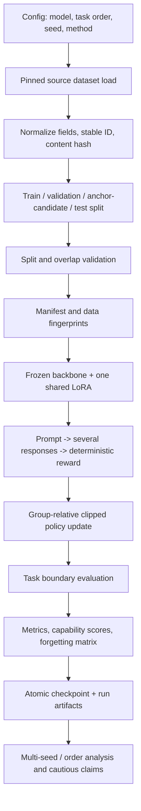

# RAHC-LoRA Project Guide — Banglish

> Ei guide-ta Bangla bhasha Latin horofe lekha (Banglish). Project-er source file-er sathe mil rekhe **implemented**, **planned**, ebong **pilot evidence** alada kore dekhano hoyeche. Nicher sample data-gulo bojhanor jonno synthetic; egulo actual dataset-er record na.

## 1. Project-er mul uddeshyo

Ei project-e dekha hocche ekta model-ke ekadhik task serially shekhale age shekha task-er performance koto ta vule jay. Model-er main language-model backbone frozen thake, ar shob task-er jonno ekta shared LoRA policy train hoy. Ete task bodlale protibar notun adapter jog hoy na.

Proposed RAHC-LoRA method-er uddeshyo holo notun task shekhar shomoy age shekha capability-r guruttopurno parameter update komano. Project-er design-e effective LoRA weight, reward-aware importance, factorized retention penalty, anchor KL, conflict gating, ebong dual control ache. Kintu current trainer-e ei shob RAHC component ekhono shesh porjonto implement hoyni; ei guide-e tai proposed design-ke current code-er sathe guliye fela hoyni.

### Ekhon code-e ki ache, ki ekhono baki

- **Chalano jay:** `rl_lora` training ebong direct dense HLoRA penalty-shoho `hlora_rl` mode.
- **Config-e nam ache kintu trainer-e fully supported noy:** `rahc_lora`, `replay`, ebong `ewc_lora`-r kichu configuration. Sudhu YAML thaka mane method implement hoye geche—eta dhora jabe na.
- **Proposed RAHC-er baki kaj:** reward-aware importance, factorized importance/penalty, anchor-based KL, gradient conflict gate, ebong dual controller-er end-to-end trainer integration.
- **Phase status:** code-e core RL/LoRA experiment-er angsho ache. Supervised SciQ/PiQA/MedMCQA/Pile reproduction-o baki bole Phase 3-ke complete bola jay na. `Goal.md` ebong source code mile current phase status abar verify kora uchit; purono status document pichiye thakte pare.

## 2. Puro workflow ek nojore



Shob dataset prothome ekshathe model-er kache deya hoy na. Ekta task train hoy, tarpor task boundary-te evaluation ebong checkpoint hoy, tarpor porer task ashe. Ei serial order-er karone ager task-er score pore komlo kina map kora jay.

## 3. Data source ebong split

Data pipeline pinned Hugging Face dataset revision theke source load kore. Revision pin korar uddeshyo holo pore dataset update holeo eki experiment abar korle eki source snapshot pawa. Nicher count-gulo repo-te documented configuration-er count; source revision-o sekhane pin kora ache.

| Task / source | Role ebong record count | Kaje byabohar |
|---|---|---|
| GSM8K (`openai/gsm8k`) | train 5,979; validation 747; anchor-candidate 747; test 1,319 | Math reasoning; official test test-i thake, train source theke validation/anchor alada kora hoy |
| ARC-Challenge (`allenai/ai2_arc`) | train 1,007; validation 299; anchor-candidate 112; test 1,172 | Multiple-choice science; official validation/test rakha hoy, train theke anchor bichchhinno |
| MBPP (`google-research-datasets/mbpp`, sanitized) | train 108; validation 43; anchor-candidate 12; test 257 | Python code generation; hidden unit test diye reward |
| Generated constraint set | mot 80; 8 template family; train 32, validation 16, anchor-candidate 16, test 16 | Format/constraint follow korar task |
| IFEval (`google/IFEval`) | 541 | Evaluation only; training-e deya jabe na |
| MMLU fixed subject subset | 623 | General capability evaluation |
| HellaSwag | 10,042 | General capability evaluation |
| ARC-Easy | 2,376 | General capability evaluation |
| WikiText-2 raw | 2,891 non-empty record | Language-model perplexity evaluation |

Exact source revision ebong detailed field/split rule-er jonno [`docs/datasets.md`](datasets.md) dekhun. IFEval, MMLU, HellaSwag, ARC-Easy, ebong WikiText evaluation set; egulo diye model train ba tune kora jabe na.

### Split-er role mane ki?

- **Train:** gradient update-er jonno prompt/target ba task input.
- **Validation:** development-e configuration ba progress dekhar jonno; final test-er bodole use kora jabe na.
- **Anchor-candidate:** purono capability dhore rakhte future anchor/KL method-er jonno alada rakha data. Current trainer eta ekhono use kore na.
- **Test:** evaluation-er jonno. Test response/label training ba tuning-e use korle test leakage hobe.
- **Evaluation-only suite:** alada benchmark; puro training/evaluation lifecycle-e training data-r baire thakbe.

Current training path train split diye update kore, task-er test split diye evaluation kore. Validation ebong anchor-candidate split ache, kintu current trainer segulo training logic-e byabohar kore na.

## 4. Data preprocessing kibhabe hoy

1. **Source snapshot load:** dataset name/configuration, revision, ebong split config theke data ana hoy. Dataset lazy-load hote pare; raw copy repository-te rakhte hoy na.
2. **Task-er field ber kora:** prottek source-er question, choices, answer, code prompt ba constraint-ke task-er expected field-e map kora hoy.
3. **Stable example ID:** nirdharito immutable source field-er upor hash kore `example_id` toyri hoy. Record order bodlaleo eki record-er identity stable thake.
4. **Content hash:** normalized record content-er hash manifest-e rakha hoy, jate split-er moddhe duplicate content dhora jay.
5. **Deterministic partition:** split seed ebong example ID mile SHA-256 order toyri kore. Ete eki config/seed-e eki record eki role-e thake.
6. **TaskExample toiri:** prottek record-e `task_id`, `example_id`, role (`train`, `validation`, `anchor_candidate`, `test`), normalized fields, ebong metadata thake.
7. **Leakage check:** eki ID ba eki content ekadhik role-e thakle split object reject kore. Constraint data-r khetre template-family diye split kora hoy, jate eki rokom template train/test-e choriye pore na.
8. **IFEval overlap audit:** generated constraint prompt-er exact ebong normalized overlap IFEval-er sathe check hoy. Documented v1.0.0 audit-e overlap zero report kora hoyeche.
9. **Manifest lekha:** dataset/source revision, split count, fingerprint, ebong overlap evidence record hoy. `prepare-data` manifest/audit toiri kore; raw dataset cache baire thake.

Ei pipeline reproducible split toyri korar cheshta kore, kintu data source-er revision, preprocessing code, config, ebong seed shob record na korle reproducibility nishchit hoy na.

## 5. Data sample — shobgulo synthetic example

Nicher sample-gulo schema bojhanor jonno banano. Egulo kono actual benchmark record ba answer key prokash kore na.

### GSM8K dhoroner math example

```json
{
  "task_id": "gsm8k",
  "example_id": "synthetic-math-001",
  "role": "train",
  "fields": {
    "question": "Rina-r kache 3 ta box ache. Prottek box-e 4 ta pencil. Mot pencil koyta?",
    "answer": "12"
  }
}
```

Prompt-e bola hoy: “Solve the problem. Give your final numeric answer clearly.” Tarpor question deya hoy. Reward function final numeric answer parse kore normalized answer-er sathe exact match check kore. Comma, percent ba rational format-er moto kichu representation normalize kora hoy. Explanation-er quality alada kore score hoy na; reward-er mul target holo shothik final answer.

### ARC-Challenge dhoroner multiple-choice example

```json
{
  "task_id": "arc_challenge",
  "example_id": "synthetic-arc-001",
  "role": "validation",
  "fields": {
    "question": "Gachher kon angsho pani mati theke tule ney?",
    "choices": {"label": ["A", "B"], "text": ["root", "flower"]},
    "answerKey": "A"
  }
}
```

Model-ke option select korte ebong label diye answer shesh korte bola hoy. Reward parser label ba unambiguous choice text dhore answer milay. Code-e ekta parser caveat ache: “Answer: A or B” rokom ambiguous output bhul kore A hisebe parse hote pare. Tai multiple-choice output-er format-ke evaluation-e kheyal rakhte hoy.

### MBPP dhoroner code-generation example

```json
{
  "task_id": "mbpp",
  "example_id": "synthetic-code-001",
  "role": "train",
  "fields": {
    "prompt": "Ekta function lekho ja list-er shob integer-er jogfol dey.",
    "tests": "hidden; model-er prompt-e deya hoy na"
  }
}
```

Generated code pinned Docker sandbox-e run hoy. Sandbox unavailable hole scoring fail-closed hoy; code-ke nijer host-e ba network access-shoho run kora uchit noy. Reward holo hidden test-er moddhe pass kora test-er fraction. Tai 4 tar moddhe 3 ta pass korle reward 0.75.

### Constraint-following example

```json
{
  "task_id": "constraints",
  "example_id": "synthetic-constraint-001",
  "role": "train",
  "fields": {
    "prompt": "Duita bullet-e ekta choto uttor dao.",
    "constraints": [
      {"kind": "bullet_count", "parameters": {"count": 2}},
      {"kind": "word_count", "parameters": {"min": 5, "max": 30}}
    ]
  }
}
```

Constraint scorer prottek constraint satisfied kina check kore; reward holo satisfied constraint-er shonkha / total constraint. Supported kind-er moddhe keyword count, bullet count, forbidden words, ending phrase, word count, required sections, ebong JSON fields ache.

## 6. Reward ebong training loop

Ekta training batch-e koyekti prompt neya hoy; prottek prompt-er jonno model-er koyekti response sample kora hoy. Example-e 2 prompt × 4 response hole mot 8 rollout. Prottek response task-specific deterministic reward pabe. `RewardResult`-e raw/normalized reward, parse success, parsed response, reward version, ebong details rakha hoy; reward finite ebong `[0,1]` range-e thaka validate hoy.

Group-er response-gulor reward theke normalized advantage ber hoy. Advantage positive hole oi response-er probability baranor dike, negative hole komanor dike update hoy. Group reward variance zero hole advantage zero rakha hoy, ebong eta log kora hoy. Tarpor clipped GRPO-style loss diye AdamW sudhu LoRA parameter update kore; backbone frozen thake. `hlora_rl` mode-e HLoRA penalty-o add hoy.

Ekta task sesh hole system task-er test evaluation kore, performance matrix-e row jog kore, capability metric lekhe, ebong task-boundary checkpoint save kore. Tarpor porer task shuru hoy. Training prompt/reward-er bistarito operational note [`docs/training.md`](training.md)-e ache.

## 7. Data analysis ebong result bujhar niyom

### Sequential performance matrix

Matrix `A[i,j]`-te row `i` mane task `i` train korar porer model; column `j` mane task `j`-er test score. Task ekhono train na hole cell missing thakbe, zero noy.

```text
                    Math test       Science test
Math training seshe    0.70              missing
Science seshe          0.60                0.50
```

Ei synthetic example-e Science shekhar por Math score 0.70 theke 0.60 hoyeche. Math forgetting holo 0.10, orthat 10 percentage point. Final average score holo final row-er mean: (0.60 + 0.50) / 2 = 0.55. Score jodi accuracy hoy tahole beshi bhalo; perplexity-r khetre kom bhalo.

- **Average forgetting:** prottek purono task-er best prior score theke final score bad diye purono task-gulor upor mean.
- **Final average:** shob task shekhar por final row-er task score-er average.
- **Backward transfer (BWT):** task shekhar porer final score minus oi task shekhar por prothom score; positive hole pore shekha task purono task-e help koreche, negative hole khoti hoyeche.

### General capability evaluation

- **IFEval:** strict ebong loose instruction-following score.
- **MMLU:** nirdishto 4-subject subset-e multiple-choice accuracy.
- **HellaSwag / ARC-Easy:** multiple-choice accuracy.
- **WikiText:** perplexity; kom hole language modeling-e bhalo.

Generative evaluation-e output label ba format bhul hole model-er underlying knowledge thakleo score kome jete pare. Tai output-format sensitivity-ke result-er limitation hisebe report kora dorkar.

### Statistics ebong evidence-er sima

Ekta seed ba choto evaluation sample diye final research claim kora uchit noy. Repo-r pilot context-e GPU run ek seed-e ebong evaluation 64 ba 128 example-e kora hoyeche; egulo **pilot evidence**, final proof noy. Main comparison-e ekadhik seed ebong task order chalao, raw per-example output rakho, uncertainty/confidence interval report koro, ebong matched/pairwise comparison korle paired statistical test use koro. Pilot result diye method-er final superiority claim kora jabe na.

Paper analysis script raw result theke summary, bootstrap interval, ebong McNemar-style paired comparison ber korte pare. Result interpret korar age run-er config, seed, task order, eval count, dataset fingerprint, ebong output format eki chilo kina verify koro.

## 8. Run-er file ebong checkpoint

Run artifact-er planned layout:

```text
outputs/runs/<experiment>/<method>/<task_order>/<seed>/<run_id>/
```

Run directory-te resolved config, manifest/fingerprint, metric log, per-example evaluation, performance matrix, capability score, system log, checkpoint index, summary, ebong checkpoint thakar kotha. Checkpoint task boundary-te atomic vabe save hoy; LoRA/model state-er sathe optimizer/scheduler, progress, RNG, matrix, config/model/data identity, ebong retention/capability state-o thake. Resume korar shomoy identity mismatch hole exact resume reject kora uchit. Current design-e mid-task checkpoint nei.

## 9. Repository-r kon jaygay ki pawa jay

- [`project.md`](../project.md): research question, equation, scientific rule, acceptance criteria.
- [`Goal.md`](../Goal.md): phase onujayi execution workflow.
- [`architecture.md`](../architecture.md): component boundary, state ownership, lifecycle.
- [`docs/datasets.md`](datasets.md): data source, revision, split, isolation.
- [`docs/training.md`](training.md): training command/config ebong run lifecycle.
- `configs/`: model, task, method, eval, experiment config.
- `src/rahc_lora/tasks/`: task record/prompt, dataset loading/preparation, split, manifest ebong data validation.
- `src/rahc_lora/rewards/`: task-wise reward implementation.
- `src/rahc_lora/models/`, `rl/`, `consolidation/`: policy, update, retention-related code.
- `src/rahc_lora/evaluation/`, `training/`: metric, evaluation ebong orchestration.
- `tests/`: unit/integration-level behavior-er executable specification.
- `scripts/` ebong `Thesis_Paper/`: experiment helper ebong paper/result analysis.

## 10. Kichu guruttopurno code/design caveat

1. Policy-r effective-gradient hook-e `grad_rows.T @ input_rows` ber korar por LoRA `layer.scaling` multiply kora hoy. Effective weight-er moddhe scaling age thekei dhora hole eta scaling abar multiply korte pare; importance interpretation-e eta check kora dorkar.
2. Direct dense HLoRA implementation-e layer coefficient-er jonno `softmax(norm_values)` use hoy; eta ekta module-e weight beshi concentrate korte pare.
3. Multiple-choice answer parser ambiguous “Answer: A or B” output-ke A parse korte pare.
4. `project.md`-e lambda-r initial value `.01`, kintu kichu config/schema default `0.0`; experiment report-e resolved config-ke source of truth dhoro ebong ei mismatch resolve koro.
5. One-seed, 64/128-example pilot ebong format-sensitive capability metric result-er certainty komay.
6. Config-e kono method-er naam thaka mane tar feature complete, tested, ba checkpoint-safe—eta proman hoy na. Implementation, test, log, ebong resume behavior dekhe status nirdharon korte hobe.

## 11. Cholar shuru korar path

Age `project.md` poro, tarpor `Goal.md` diye current phase bujho. Data split/detail-er jonno `docs/datasets.md`, trainer flow-er jonno `docs/training.md`, tarpor relevant `src/` module ebong tests poro. Local environment-e command chalanor age config/model/data access setup check koro.

Common CLI entry point-gulo:

```text
python -m rahc_lora.cli doctor
python -m rahc_lora.cli prepare-data
python -m rahc_lora.cli train ...
```

`doctor` environment/config readiness check-er jonno; `prepare-data` split manifest/audit-er jonno; `train` configured run shuru kore. Long GPU run ba multi-seed sweep shuru korar age scope, GPU time, seed/order, ebong evaluation size nirdishto kore approval nite hoy.

### Choto glossary

- **LoRA:** frozen boro weight-er pashe trainable low-rank update.
- **Shared policy:** eki LoRA parameter shob sequential task-e use hoy.
- **Anchor:** purono behavior mone rakhte rakha alada example set.
- **Reward-aware importance:** kon parameter purono task-er reward-e kotota guruttopurno, tar estimate.
- **Forgetting:** porer task shekhar por ager task-er performance kome jawa.
- **Pilot evidence:** choto/initial run theke paoa signal; final claim-er jonno jothesto evidence noy.
- **Data leakage:** test/evaluation-er tothyo training ba tuning-e probesh kora.

## Source documents

Guide-ti repository-r [`project.md`](../project.md), [`Goal.md`](../Goal.md), [`architecture.md`](../architecture.md), [`docs/datasets.md`](datasets.md), ebong [`docs/training.md`](training.md)-er upor bhitti kore. Repo-te implementation status evolve korle ei guide ebong status document update kore nite hobe.
